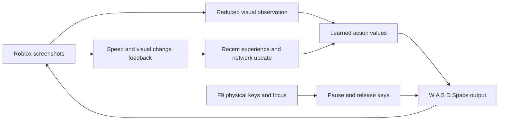

# Driving Empire autopilot architecture

## Goal and current boundary

The long-term goal is a screen-only agent that learns to drive from its own actions and outcomes. Route finding is a separate later goal. The game does not provide this program with coordinates, collision events, or a reset API. Every training reward must therefore be estimated from visible frames.

Version 1 (`autodrive.py`) is a supervised road follower: it captures the Roblox window, estimates a nearby path from road color and markings, sends short W/A/D inputs, and releases them on F9, manual takeover, focus loss, or lost road detection. Version 2 (`v2/autodrive.py`) also has manual imitation learning and a road-alignment steering table. Its `self_train_auto` mode is separate: a small visual reinforcement-learning network chooses driving keys from screenshots and zero/nonzero speed feedback without calling the road pathfinder. Its respawn sequence was checked against the supplied recording, but not in a live run. Both versions still require supervision.

The user has confirmed that simulated throttle and steering move the car and that A steers left. Offline checks on the three supplied screenshots produce paths on two road scenes and no path at the intersection. Version 2's save/train/load path was tested with generated examples; live learned driving remains unverified because no manual recording and trained model exist yet.

## Visual AI data flow

This loop is implemented in Version 2's `self_train_auto` mode. Its feedback is a weak proxy for driving quality, and the network has not been evaluated live. Version 1 and the other Version 2 modes use separate road-following or imitation logic.

## Component contracts

| Component | Input → output | Status |
| --- | --- | --- |
| Screen capture | Visible Roblox client area → timestamped BGR frame | Implemented in both versions; live behavior depends on the game window remaining visible. |
| Road detection | Frame and calibrated asphalt color → short path or no result | Implemented in Version 1; can confuse similar-colored pavement. |
| Vehicle state | Frames → speed, heading, road-relative position, stuck/collision confidence | Road-relative position is approximate. Version 2 distinguishes zero from nonzero speed when the HUD is visible; numeric speed, vehicle heading, and collision detection remain unimplemented. |
| Driving control | Path or learned visual policy → short keyboard actions | Version 1 follows a short path; Version 2 visual AI chooses W/A/S/D/Space combinations. Its F/T/car-tile recovery after prolonged zero speed is experimental. |
| Safety control | F9, physical takeover, focus, capture and confidence → release all assistant keys | Implemented for normal operation; a frozen process cannot guarantee a key release. |
| Experience storage | Observation, action, outcome → training data | Version 2 saves manual steering examples. The visual AI keeps recent screenshot features, actions, and rewards in memory; only its network weights and step count persist across runs. |
| Learning and checkpoints | Visual observations and feedback → updated action policy | Version 2 has a manual-example model, a road-alignment table, and a small visual Q-network. Verified on-road progress rewards, automated evaluation, and rollback do not exist. |
| Localization and map | Minimap and visual landmarks → place estimate and road graph | Unimplemented. Do not infer global coordinates from the current road preview. |
| Planning | Verified road graph and destination → route/frontier choice | Unimplemented. Road-following modes pause at uncertain intersections; the visual AI may act there without understanding routes. |
| Desktop UI | Preview, controls, confidence, training and map statistics | Basic OpenCV preview exists; the requested full interface is unimplemented. |

## Milestones and acceptance checks

1. **Supervised MVP — partly implemented.** Confirm keyboard input works in Roblox, the preview stays aligned with the chase camera, road paths cover marked and unmarked sample roads, and an ambiguous intersection produces no drive command. On a short clear road, test low-speed steering with a person ready to press F9. Record at least one manual-driving session and verify that Version 2 can load its saved model. Offline frame checks have passed; a complete live acceptance run has not been demonstrated for Version 2.
2. **Reliable perception and measured state.** Extend the current zero/nonzero speed check to a numeric speed reading, temporal heading, road-edge confidence, and stuck/collision evidence from recordings. Evaluate on separate day/night, curve, intersection, traffic, and off-road clips. Uncertain frames should release driving input and trigger another observation; the detector must not label every gray surface as road.
3. **Map and localization.** Record a topological graph of verified intersections and road segments in SQLite. Associate each node with minimap and landmark evidence, and accept a loop closure only when a revisited junction is independently recognizable. Show the graph in a read-only preview before using it to choose turns.
4. **Learning with measurable outcomes.** The road-alignment experiment scores alignment; the visual AI scores movement and scene change. Neither proves good road driving. Compare Version 1, imitation learning, and the visual policy on the same held-out routes. Build verified progress, on-road time, collision, and steering-smoothness rewards. Test them on recordings and a local simulator before live exploration. Save candidate checkpoints and promote one only after it beats the previous model on the same evaluation set; keep the previous checkpoint for rollback.
5. **Exploration and navigation.** Allow only verified intersections into the graph, choose a reachable frontier, and stop if localization or road confidence is lost. Add destination routing after repeated supervised runs demonstrate reliable turn execution and return to known places.
6. **Full interface and camera work.** Add training/exploration controls and statistics that are backed by measured data. Keep the driving camera fixed; investigate cinematic framing separately after road tracking is reliable.

## Why days of unattended driving are not a training plan yet

The visual AI can learn key choices from trial and error, but movement and scene change can reward driving off road or circling. The supplied recording shows F to exit and T to open the car menu. `self_train_auto` explores driving actions for 20 seconds at zero speed, then locates the Collections header and clicks a visible car card. It also attempts this sequence when the speed display is missing and the player may already be out of the car. Failed recovery keeps the learner running and schedules another attempt; loss of Roblox focus releases the keys until focus returns. This has only been checked against screenshots and recordings; live recovery and general off-road recovery are unverified. F9 and physical driving keys remain the immediate takeover controls.
